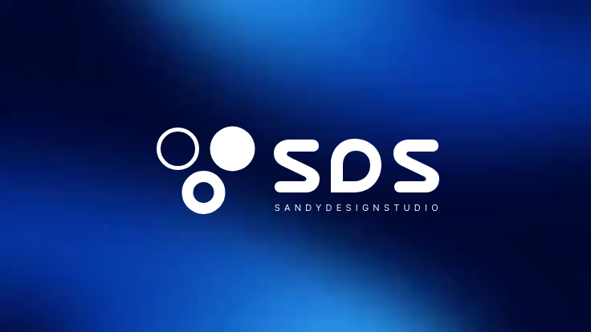

# Sandy Design Studio — Remotion recreation

A component-based reconstruction of **“by sandydesignstudio”**, Motionface recording [`0b66f6e0-a1a5-457c-a4b2-d903a75df7f5`](https://motionface.cc/?recording=0b66f6e0-a1a5-457c-a4b2-d903a75df7f5).

The sequence recreates the blue light field, kinetic copy, changing design-tool icons, accelerating service wheel, perspective portfolio carousel, and three-circle SDS finale. Animations are deterministic React/SVG/CSS transforms driven by Remotion's frame number. There is no reference-video playback layer.



## Run

Node.js 22.13+ is recommended. From a fresh clone:

```sh
npm ci
npm run dev
```

Select **SandyRecreation** in Remotion Studio. Scrub or play the entire timeline. Fonts, artwork, and audio are bundled locally; rendering requires no account, token, or remote media URL. Remotion may download its rendering browser on the first render.

## Render

```sh
# Original reference dimensions: 736 × 414, 30 fps, 629 frames
npm run render

# 1920 × 1080 export with the same layout and timing
npm run render:hd

# Closing lockup still
npm run poster

# TypeScript / ESLint, bundle, and output metadata validation
npm run check
npm run build
npm run verify:render
```

Outputs are written to `out/`, which is ignored by Git. `npm run render -- --concurrency=2` reduces memory use. HD uses the same reference-derived raster artwork with sharper vector text and shapes; it does not invent higher-resolution source footage.

## Source map

| File | Responsibility |
| --- | --- |
| `src/Root.tsx` | Original-size and HD compositions |
| `src/timing.ts` | Metadata, scene boundaries, clamped frame interpolation |
| `src/components/KineticType.tsx` | Copy, word reveals, icon choreography |
| `src/components/ToolIcon.tsx` | Sixteen editable SVG design-tool glyphs |
| `src/components/ServiceWheel.tsx` | Curved, accelerating typographic wheel |
| `src/components/PortfolioCarousel.tsx` | Individually transformed 3D artwork cards |
| `src/components/LogoFinale.tsx` | Measured circle trajectories and SDS reveal |
| `public/` | Local artwork, soundtrack, and OFL fonts |
| `docs/source-study.md` | Reference measurements, decisions, fidelity limits |
| `docs/verification.md` | Actual validation results |
| `scripts/prepare-assets.py` | Optional extraction tool for a separately supplied local reference |

## Attribution and fidelity

The original creative work, brand identity, portfolio imagery, and soundtrack are credited to **Sandy Design Studio**. The small card textures, static background, soundtrack, and redrawn SDS wordmark derive from the user-supplied reference. The repository reconstructs the motion in editable components; card interiors use sampled artwork rather than reproducing all the films playing inside the original cards. Inter Tight is bundled under its SIL Open Font License in `public/fonts/OFL.txt`. The reference font was visually approximated with Inter Tight.

This repository does not grant rights to third-party branding, imagery, or music. No blanket license is applied to the original creative assets. The private reference download URL, the full reference video, and repository-binding credentials are not included.
